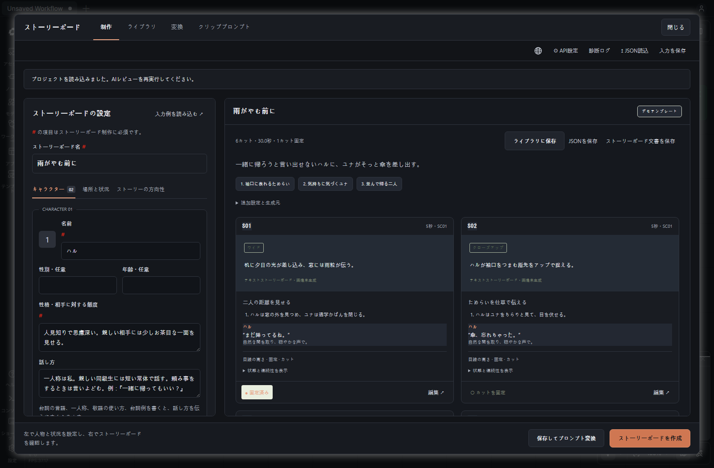
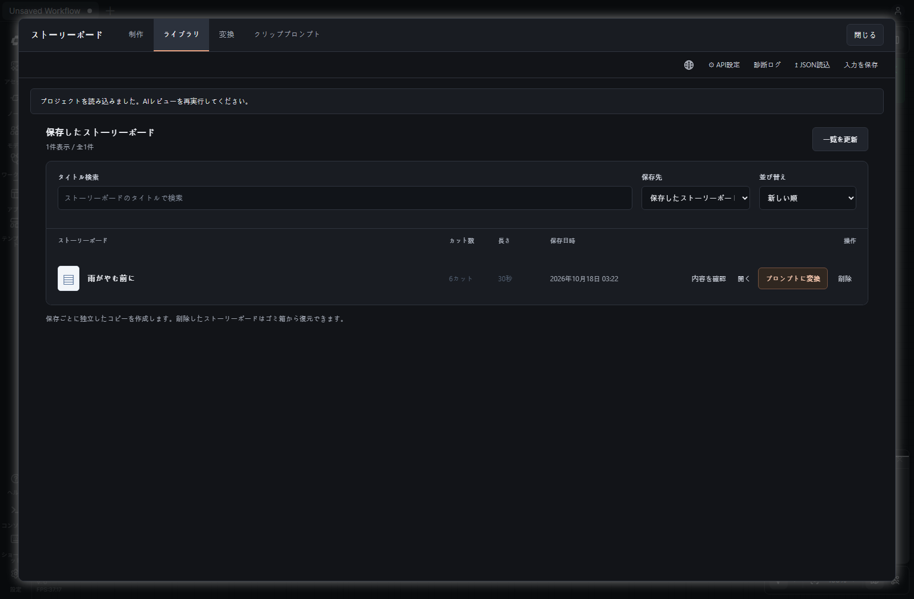
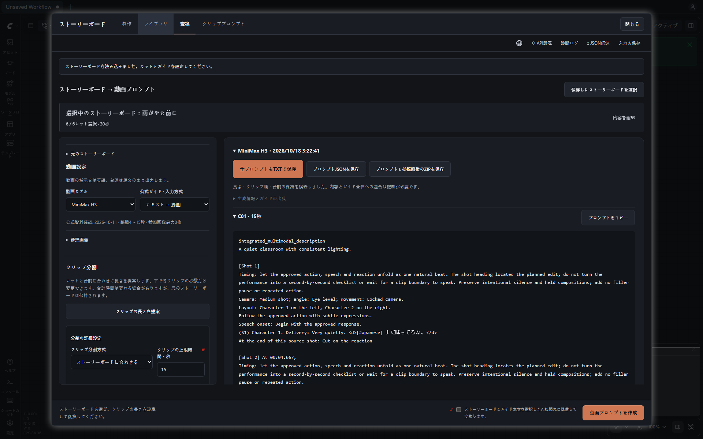
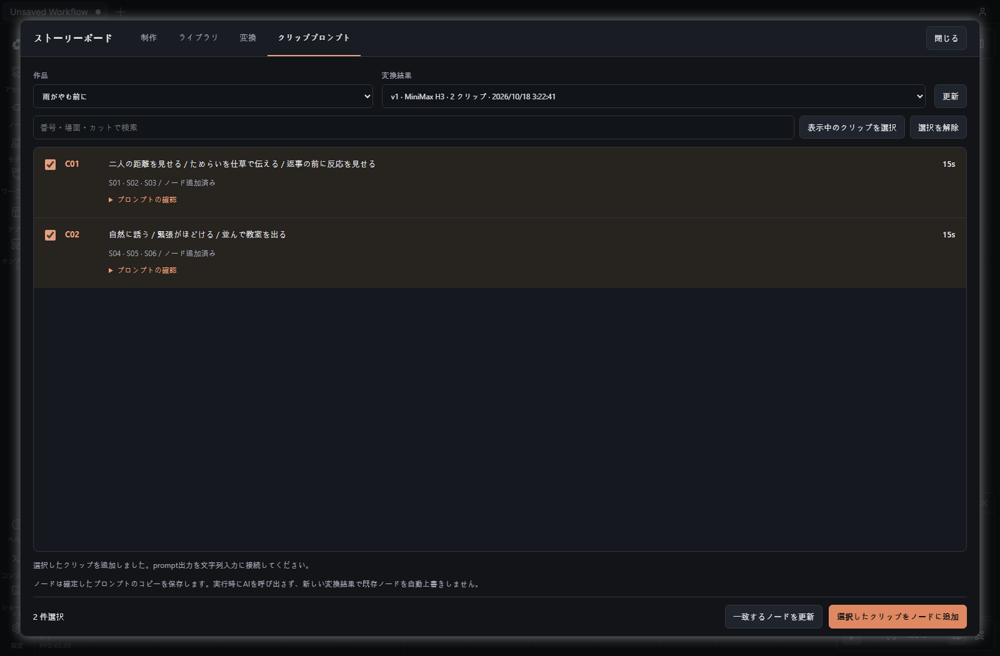
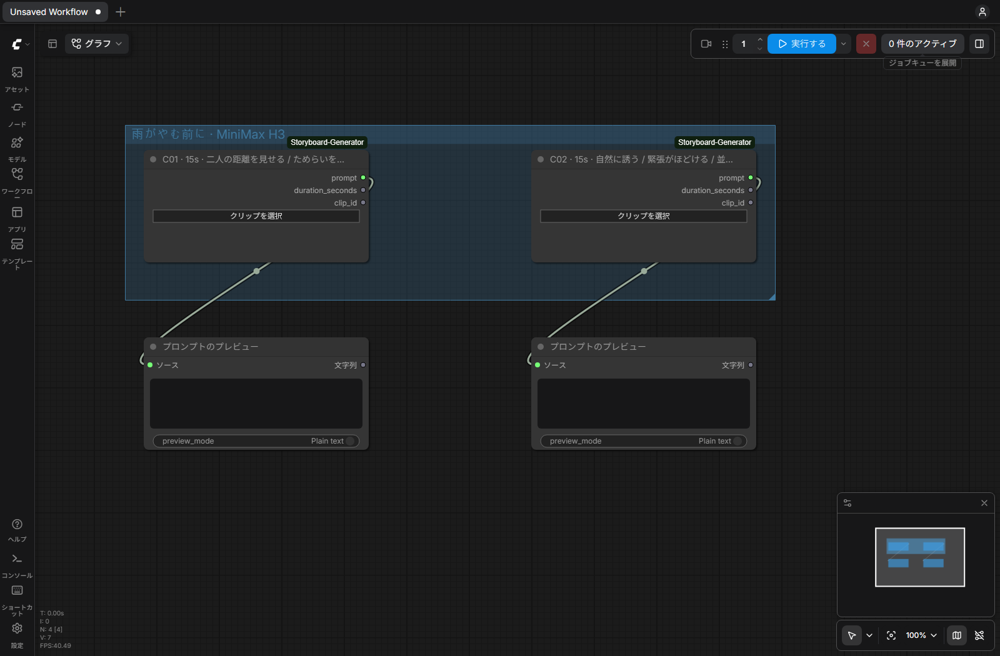

# ComfyUI Storyboard Generator

[インストールせずに体験](https://impacifist.github.io/ComfyUI-Storyboard-Generator/) — 固定サンプルのカットと動画プロンプトを確認し、接続済みSTRINGノードをダウンロードできます。実際のAI・動画生成は行わず、APIキーも不要です。

正常な結果のカット数だけが指定と異なる場合、指定数・生成数と内容を確認し、**この結果を使う**か**再生成**を選べます。使用時にAIを追加で呼び出すことはなく、再生成に失敗しても前の結果を保持します。選択前にJSONで保存することもできます。人物や固定カットの検証は維持されます。再読み込み前に、未確定の結果を使用するかJSONで保存してください。

[English](README.md) | [한국어](README.ko.md) | 日本語

ComfyUIの中でストーリーボードを作成し、MiniMax H3、Seedance、LTX 2.5向けの動画プロンプトに変換できます。各クリップのプロンプトを個別の**STRING出力ノード**として、動画ワークフローに接続します。

独立したComfyUIカスタムノードです。[Webアプリ版のAI Video Storyboard Generator](https://github.com/impacifist/ai-video-storyboard-generator)とは別にインストールでき、専用のWebサーバーを起動する必要はありません。

## 完成したアニメーションの例

https://github.com/user-attachments/assets/0d82f51c-8621-4540-af1c-118edf0df261

30秒分のストーリーボードを抜粋し、MiniMax H3で生成して27.46秒に編集した作品です。キャラクターの性格と会話の流れを、セリフ・演技・カメラの構図に落とし込みました。日本語のセリフは制作者が確認・修正しています。以下の模擬AIによる操作例とは別の、実際に生成した動画です。



## 4つの手順で使ってみる

画像は、テスト用のComfyUIで日本語UIと手作業で作成した日本語サンプルを使って撮影しました。変換応答はUI検証用の模擬データです。実際のAI生成品質や完成動画を示すものではありません。動画の演出指示は英語、セリフは日本語のまま出力します。

### 1. キャラクターと物語を設定する

ComfyUI上部の動画アイコンから**Storyboard**を開きます。**Extensions → Storyboard**からも開けます。**API settings**で利用するAIを設定してください。

**Create**で、キャラクター、場所、状況、物語の方向性、目標尺、カット数を入力します。キャラクターは1〜5人まで登録でき、性格や話し方も指定できます。**#**が付いた項目は必須です。

**Create a storyboard**を押すと、右側でカットを確認・編集できます。必要なカットを固定し、**Save and convert**で新しいコピーを保存して変換に進みます。操作を先に試すには**Load example**を使ってください。デモモードはAIを呼ばず、テンプレートを使用します。

画像と同じ内容を試すには、[日本語サンプルJSON](examples/before-the-rain-stops.ja.storyboard.json)を読み込んでください。保存した作品は**ライブラリ**から開き直せます。



### 2. 承認したカットを動画プロンプトに変換する



**Convert**で保存済みのストーリーボードを選び、**MiniMax H3**または**Seedance**のガイドを指定します。対象カットを確認し、長さの提案や詳細設定を使ってクリップを分割してください。各クリップの秒数を変更したら、分割を適用してから変換します。

画像の例では30秒のストーリーボードを15秒ずつの2本に分割しています。手動で長さを変えると合計尺も変わる場合があるため、変換前にクリップ数と合計時間を確認してください。

変換するAIとモデルを選び、送信への同意欄をチェックして**Generate video prompts**を押します。結果を確認し、必要に応じてTXT、JSON、参照画像付きZIPで保存できます。元のカット、参照画像、Ollamaのメモリー設定は、必要なときに展開できます。

### 3. キャンバスに追加するクリップを選ぶ



**Clip prompts**で作品と変換バージョンを選びます。クリップ番号、場面、元のカットで検索し、**Prompt preview**で内容を確認してください。必要なクリップを選択し、**Add selected clips as nodes**を押すとノードが追加されます。検索しても選択は保持されます。

一覧には、ノードの追加済み状態、プロンプト出力の接続状態、別バージョンの使用状態を表示します。ノードは作品ごとのグループに配置します。

新しい変換結果を作っても、既存のノードは自動的に書き換えません。更新したい場合は**Update matching nodes**を使用します。同じ作品と元のカット構成に対応するノードを明示的に更新し、接続線を維持します。分割変更で元のカット構成が変わった場合は、対象ノードを個別に選び直してください。`C01`だけでは作品や変換バージョンを特定できません。

### 4. 動画ワークフローに接続する



画像では、動画を生成せずに実際の文字列接続を示すため、**PreviewAny**に接続しています。実際のワークフローでは、クリップごとの`prompt`を対応する動画ノードのプロンプト入力に接続してください。接続先がテキスト入力欄の場合は、そのノードが対応していれば先に入力ソケットへ変換します。

| 出力 | 型 | 接続先の例 |
| --- | --- | --- |
| `prompt` | STRING | 動画ノードのプロンプト入力、文字列処理ノード |
| `duration_seconds` | FLOAT | 対応する動画ワークフローの長さ入力 |
| `clip_id` | STRING | クリップ名などの文字列入力 |

各ノードの**Choose clip**から、ノードと接続線を残したまま別のクリップに変更できます。

プロンプトのコピー、長さ、識別情報はワークフローJSONに保存します。元のローカルライブラリーがないPCでも、保存したプロンプトを読み込めます。チェックサムは誤った変更の検出用であり、真正性を保証する署名ではありません。

**キュー実行時にLLMを再度呼び出すことはありません。** 保存済みのプロンプトをそのまま出力します。キャラクターと背景の参照画像は、参照manifestの順序に従って動画生成ノードへ別途接続してください。このノードパックはプロンプトを用意するもので、動画の生成やクリップの自動結合は行いません。

H3・Seedanceの画像参照方式では、**参考画像を追加**から**人物・背景・小物・その他**を選べます。同じ対象の画像をまとめ、適用するカットも指定できます。小物の持ち主や受け渡しは元のカット設定を維持します。その他には照明・色合いなど、参考にする内容を入力してください。画像の解析や自動転送は行わないため、動画ワークフローには手動で接続します。LTXは従来の開始画像方式を使います。

## インストール

Python 3.12以降と、フロントエンド拡張に対応したComfyUIが必要です。`ComfyUI/custom_nodes`フォルダーで次のコマンドを実行します。

```sh
git clone https://github.com/impacifist/ComfyUI-Storyboard-Generator.git
```

ZIPの場合は、`custom_nodes/ComfyUI-Storyboard-Generator`の直下に`__init__.py`が入るように展開してください。ComfyUIを再起動し、ブラウザーを再読み込みします。追加の実行用Pythonパッケージはインストールしません。aiohttpはComfyUIの環境に含まれるものを使用します。

パネルからOpenAI、Anthropic Claude、Ollama、LM Studio、OpenAI互換接続を設定できます。ローカルLLMのソフトウェアとモデルは別途用意してください。

初期実装はComfyUI 0.41.1 / frontend 1.55.17で検証しています。他のバージョンとの互換性は別途確認が必要です。上部のボタンにはフロントエンドの`actionBarButtons`フックを使用し、コマンドと上部メニューからも開けます。

## Ollamaのモデルを解放する

変換画面の**Unload Ollama after prompt conversion**は既定で有効です。選択状態はブラウザーに保存します。全クリップの変換、内部修正、結果の保存が完了してから、使用したOllamaモデルを一度だけアンロードします。クリップごと、または処理の途中では解放しません。

**Unload selected Ollama model now**では手動で解放できます。変換用のOllamaモデルを優先し、変換で別の提供者を使う場合は制作用モデルを対象にします。ボタンにモデルIDを表示します。このアドオンでAI処理中の場合は、同時に手動アンロードできません。

[Ollama公式の方式](https://docs.ollama.com/faq#how-do-i-keep-a-model-loaded-in-memory-or-make-it-unload-immediately)に従い、`keep_alive: 0`を指定した空の`/api/generate`リクエストを送ります。シェル実行やプロセスの強制終了は行いません。対象は設定済みローカルOllamaサーバーの選択モデルだけです。

`done: true`と`done_reason: unload`を確認できた場合に成功とします。失敗や未確認の場合は別途表示し、保存済みのプロンプトは破棄しません。解放リクエストのソケット待機上限は15秒です。変換に失敗した場合は自動解放しないため、必要に応じて手動操作を使ってください。

同じモデルを共有する別のアプリでは、次の使用時に再読み込みが必要になることがあります。実際のVRAM解放量を測定する機能や、ComfyUIの動画モデルをアンロードする機能ではありません。自動テストでは実際のOllamaモデルを解放していません。[設計と検証](docs/OLLAMA_MEMORY.md)も参照してください。

## データの保存とAIへの送信

- 制作データと設定は、ComfyUIのユーザーディレクトリー内の`storyboard-generator/`に保存します。通常は`ComfyUI/user/storyboard-generator/`です。`STORYBOARD_DATA_DIR`で変更できます。Webアプリ版のデータや設定は自動コピーしません。
- APIキーはローカル設定に平文で保存し、クリップのスナップショット、グラフのプロパティ、ワークフローの書き出しには含めません。
- AIによる生成・検査・変換はパネルで明示的に操作した場合に行います。キュー実行ではAI、作品データベース、プロンプト更新処理にアクセスせず、動画生成も送信しません。
- このバージョンは同じPCからの個人利用向けです。ループバックと同一オリジンからのリクエストのみを許可し、リモート接続や複数ユーザーでの利用は対象外です。
- 参照画像は制作パネルで管理できますが、現在のノードはIMAGEテンソルを出力しません。動画ノードへの画像接続は別途行ってください。

UIは英語・韓国語・日本語に対応します。動画の演出指示は英語で出力し、承認したセリフは元の言語のまま保持します。

## 共通エンジン

制作エンジンとStudioのファイルには、Webアプリ版v0.5.7-betaの変更していない固定スナップショットを使用します。`_vendor/upstream.json`に元のコミットと全ファイルのSHA-256を記録しています。ComfyUI固有の処理は`_vendor`の外にあります。

ループバック接続のLLMリクエストには、アプリ側のソケット時間制限を設けていません。最初の応答まで3分以上かかるモデルも利用できます。ローカル出力上限の設定と、セッション内の診断ログもパネルから確認できます。

共通エンジンは現時点では独立したインストール用パッケージになっていません。この固定スナップショットにより、実行時のコード取得やWebアプリ版サーバーなしでインストールできます。

開発時に、意図した上流リビジョンをローカルのチェックアウトから取り込む場合：

```powershell
python tools/sync_upstream.py "C:\path\to\ai-video-storyboard-generator" <full-commit-or-tag>
```

取り込みツールはスナップショット内にローカル変更があれば中止します。更新内容をレビューし、テストしてから公開してください。

## 開発と検証

```powershell
python -m unittest discover -s tests -p "test_*.py" -q
python -m ruff check .
node --check web/storyboard.js
node --check panel/bridge.js
node --check panel/workbench.js
```

ブラウザーテストにはPlaywrightとChromiumが必要です。`tools/test_comfy.py`は、専用の一時入出力・ユーザーディレクトリーでCPU専用のComfyUIを起動し、このノードパックだけを読み込みます。模擬の変換結果を使い、実際のフロントエンドと文字列だけのキュー実行を検査します。既存サーバーの再起動や、有料AI・動画生成サービスの呼び出しは行いません。

```powershell
python tools/test_comfy.py --comfy "C:\path\to\ComfyUI" --python "C:\path\to\python_embeded\python.exe"
```

詳細は[アーキテクチャと実装範囲](docs/ARCHITECTURE.md)、[検証記録](docs/VALIDATION.md)、[画面設計](docs/DESIGN_COMFYUI.md)をご覧ください。
