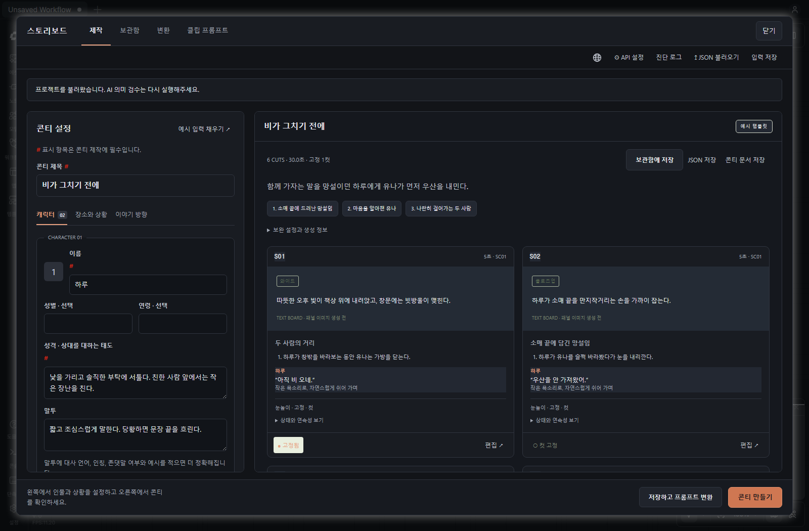
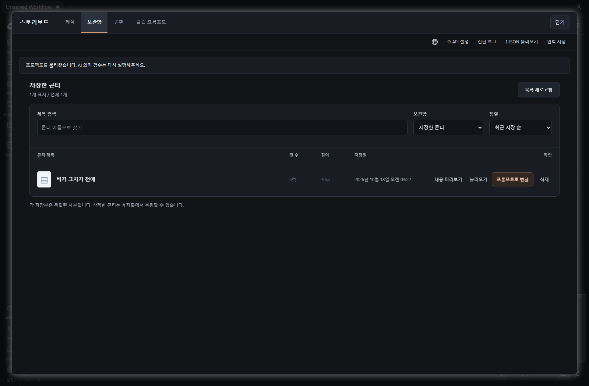
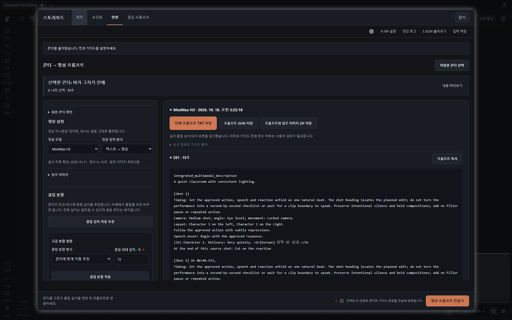
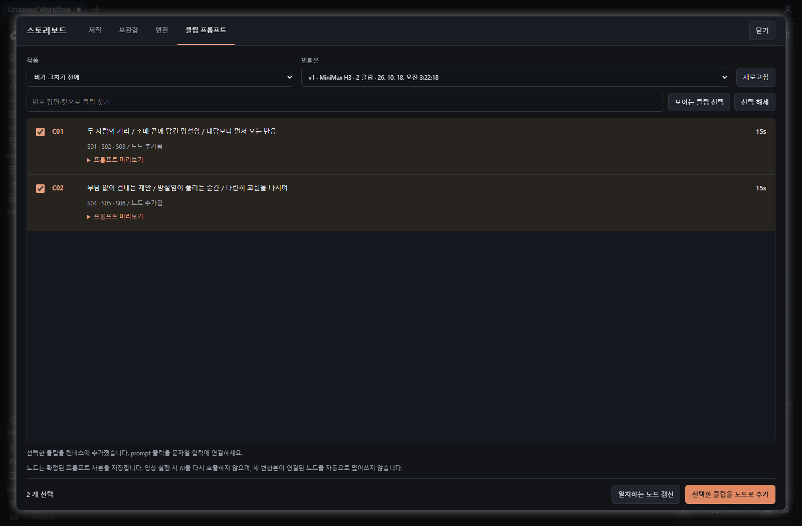
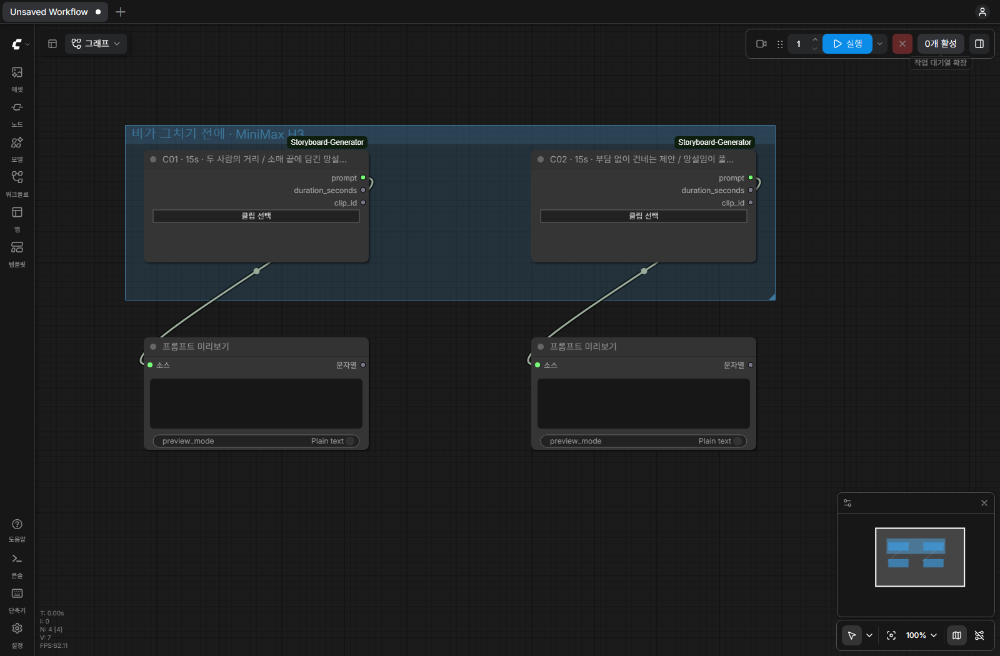

# ComfyUI 스토리보드 생성기

[English](README.md) | 한국어 | [日本語](README.ja.md)

ComfyUI 상단의 **Storyboard** 아이콘을 눌러 콘티를 직접 제작하고, 변환한 클립별 프롬프트를 문자열 출력 노드로 연결합니다. **Extensions → Storyboard** 메뉴에서도 열 수 있습니다.

## 완성 애니메이션 예시

https://github.com/user-attachments/assets/0d82f51c-8621-4540-af1c-118edf0df261

30초 분량의 콘티를 발췌해 MiniMax H3로 제작하고 27.46초로 편집한 실제 결과입니다. 직접 정한 캐릭터 성격과 대화 흐름을 생성기로 대사·행동·카메라 연출에 반영했고, 일본어 대사는 제작자가 검수·첨삭했습니다. 아래의 모의 AI 사용 화면과 구분되는 완성 영상 사례입니다.



## 화면으로 따라 하기

아래 이미지는 별도의 테스트용 ComfyUI에서 한국어 UI와 직접 작성한 한국어 예시로 촬영했습니다. 변환 응답은 화면 검증용 모의 데이터이며 실제 AI 생성 품질이나 완성 영상을 보여주는 예시는 아닙니다. 각 언어 설명서에 같은 언어의 화면과 예시를 연결했습니다.

### 1. 인물과 이야기를 설정합니다

상단 **Storyboard → API settings**에서 사용할 AI를 설정합니다. **Create**에서는 등장인물, 장소, 이야기 방향, 목표 길이와 컷 수를 입력하세요. 페르소나는 최대 5명까지 추가하며 성격과 말투를 함께 적을 수 있습니다. **#**가 붙은 항목은 필수입니다.

**Create a storyboard**로 콘티를 만든 다음 오른쪽에서 컷을 확인하고 수정합니다. **Save and convert**를 누르면 새 사본을 저장하고 변환 화면으로 이동합니다. 먼저 사용법을 둘러보려면 **Load example**로 예시를 채워보세요. 데모 모드는 AI 호출 없이 템플릿을 사용합니다.

위 화면과 같은 예시를 사용하려면 [한국어 샘플 JSON](examples/before-the-rain-stops.ko.storyboard.json)을 불러오세요. 저장한 작품은 **보관함**에서 다시 열 수 있습니다.



### 2. 콘티를 영상 프롬프트로 변환합니다



저장된 콘티와 **MiniMax H3 / Seedance** 가이드를 선택합니다. 사용할 컷을 확인하고 클립 길이를 정한 뒤 분할을 적용하세요. 예시는 30초 콘티를 15초씩 두 클립으로 나눕니다. 수동으로 길이를 바꾸면 합계가 달라질 수 있으므로 분할 결과를 확인하세요.

변환용 AI와 모델을 선택하고 요청 동의란을 체크한 뒤 **Generate video prompts**를 누릅니다. 결과를 검토하고 필요하면 TXT·JSON·ZIP으로 내려받을 수 있습니다. Ollama를 사용한다면 변환 후 해당 LLM을 언로드할 수 있습니다. ComfyUI의 영상 모델을 내리는 기능은 아닙니다.

### 3. 필요한 클립을 골라 노드로 추가합니다



**Clip prompts**에서 작품과 변환본을 고릅니다. 클립 번호·장면·원본 컷으로 검색하고 **Prompt preview**에서 내용을 확인하세요. 원하는 클립을 체크하고 **Add selected clips as nodes**를 누릅니다. 목록에는 노드 추가 여부와 연결 상태가 표시됩니다.

새 변환본을 만들어도 기존 노드가 자동 변경되지는 않습니다. 갱신이 필요할 때 **Update matching nodes**를 사용하세요.

### 4. 영상 워크플로우에 연결합니다



위 화면은 영상을 생성하지 않고 문자열 연결을 보여주기 위해 **PreviewAny**를 사용했습니다. 실제 작업에서는 각 클립의 `prompt` 출력을 해당 영상 노드의 프롬프트 입력에 연결하세요. 텍스트 입력칸만 있다면 해당 노드가 지원하는 경우 먼저 입력 소켓으로 변환해야 합니다.

| 출력 | 타입 | 용도 |
| --- | --- | --- |
| `prompt` | STRING | 영상 프롬프트 입력 또는 문자열 처리 노드 |
| `duration_seconds` | FLOAT | 호환되는 영상 길이 입력에 연결 |
| `clip_id` | STRING | 클립 이름 등 문자열 입력에 활용 |

**Choose clip**으로 기존 연결선을 유지하면서 다른 클립을 배정할 수 있습니다. 프롬프트 사본은 워크플로우에 저장되며 큐 실행 시 LLM을 다시 호출하지 않습니다. 캐릭터·배경 참조 이미지는 참조 목록의 순서에 맞춰 영상 노드에 별도로 연결하세요. 이 도구는 프롬프트를 준비하며, 영상 생성과 클립 연결은 사용 중인 영상 워크플로우에서 처리합니다.

H3·씨댄스 이미지 참조 방식의 **레퍼런스 추가**에서 **인물·배경·소품·그 외**를 선택합니다. 한 대상에 여러 이미지를 묶고 적용할 컷을 지정할 수 있습니다. 소품의 소유자와 전달은 원본 콘티를 따르며, 그 외는 조명·색감처럼 참고할 내용을 입력합니다. 이미지 자체를 분석하거나 자동 전달하지 않으므로 영상 워크플로우에는 직접 연결하세요. LTX는 기존 시작 이미지 방식을 사용합니다.

## 사용 흐름

1. 상단 **제작·보관함·변환·클립 프롬프트**에서 작업을 선택합니다. 제작에서는 API 설정, 페르소나 1~5명, 장소·상황·이야기 방향을 입력합니다. 기존 콘티 JSON도 불러올 수 있습니다.
2. 왼쪽에서 입력하고 오른쪽에서 콘티를 확인·수정합니다. 하단 **콘티 만들기** 버튼은 스크롤해도 유지됩니다. **저장하고 프롬프트 변환**으로 새 사본을 저장하고 바로 다음 작업을 시작할 수 있습니다. 변환도 왼쪽 설정·오른쪽 결과로 구성하고 **영상 프롬프트 만들기** 버튼을 하단에 고정했습니다. 원본 콘티·참조 이미지·Ollama 메모리는 필요할 때 펼칩니다. [화면 설계](docs/DESIGN_COMFYUI.md)
3. **클립 프롬프트**에서 작품과 변환본을 고릅니다. 번호·장면·원본 컷으로 검색하고 프롬프트를 미리 확인합니다.
4. 클립을 선택해 **선택한 클립을 노드로 추가**합니다. 각 노드의 `prompt`를 영상 생성 노드나 문자열 입력에 연결합니다. `duration_seconds`와 `clip_id`도 출력합니다.
5. 노드의 **클립 선택** 버튼으로 다른 클립을 배정할 수 있습니다. 기존 연결선은 유지됩니다.

노드는 작품별 그룹으로 배치되며 목록에는 추가 여부·prompt 출력 연결 여부·다른 변환본 사용 여부를 표시합니다. 새 변환본을 만들어도 기존 노드는 자동 변경하지 않습니다. **일치하는 노드 갱신**을 명시적으로 선택하면 같은 작품·클립·원본 컷 구성이 일치하는 노드를 갱신합니다. 분할 변경으로 원본 컷 구성이 달라졌다면 해당 노드에서 직접 클립을 다시 선택하세요.

프롬프트 사본과 길이는 워크플로우에 저장됩니다. 다시 열거나 다른 PC에서 사용해도 기존 문자열을 복원하며, 영상 실행 시 AI를 다시 호출하지 않습니다. API 키는 워크플로우에 넣지 않습니다.

## 설치와 저장 위치

변환 화면의 **프롬프트 변환 후 Ollama 자동 언로드**는 기본으로 켜져 있고 브라우저에 선택을 기억합니다. 전체 변환·내부 수정·저장을 마친 뒤 사용한 모델만 한 번 해제하며, 클립별 처리 중간에는 내리지 않습니다. **선택한 Ollama 모델 지금 언로드** 버튼으로 직접 해제할 수도 있습니다. 버튼에 대상 모델 ID를 표시하며 변환의 Ollama 모델을 우선 사용하고, 변환이 다른 제공자라면 제작의 Ollama 모델을 사용합니다.

언로드 실패나 미확인 상태는 별도로 알리고 이미 저장한 프롬프트는 보존합니다. 이 노드팩에서 AI 요청 중에는 수동 언로드를 차단합니다. 언로드 요청에는 15초 소켓 대기 제한을 적용하며, 실패한 변환은 자동 언로드하지 않으므로 필요하면 수동 버튼을 사용하세요. 같은 모델을 공유하는 다른 앱은 모델을 다시 로드해야 할 수 있습니다. Ollama 서버의 언로드 확인이며 실제 VRAM 반환량을 측정하거나 ComfyUI의 영상 모델을 내리는 기능은 아닙니다. [설계·검증 근거](docs/OLLAMA_MEMORY.md)

Python 3.12 이상이 필요합니다. 저장소 폴더를 `ComfyUI/custom_nodes/ComfyUI-Storyboard-Generator`에 두고 ComfyUI 재시작 후 브라우저를 새로고침하세요. 별도의 웹 서버는 실행하지 않습니다.

`ComfyUI/custom_nodes` 폴더에서 설치하세요.

```sh
git clone https://github.com/impacifist/ComfyUI-Storyboard-Generator.git
```

ZIP으로 설치한다면 압축을 풀어 `custom_nodes/ComfyUI-Storyboard-Generator` 바로 아래에 `__init__.py`가 있도록 배치하세요. 재시작 후 패널에서 AI 제공자를 설정합니다. OpenAI, Anthropic Claude, Ollama, LM Studio와 OpenAI 호환 API를 지원합니다. 로컬 LLM 프로그램과 모델 가중치는 별도로 설치해야 합니다.

콘티·참조 이미지·API 설정은 ComfyUI의 user 디렉터리 아래 `storyboard-generator`에 따로 저장합니다. 기존 독립 웹 앱의 데이터와 설정은 변경하거나 자동 복사하지 않습니다. API 키는 로컬 평문 파일에 보관합니다. 첫 버전은 같은 PC에서 접속하는 사용을 대상으로 하며 원격·다중 사용자 접속은 지원하지 않습니다.

참조 이미지는 제작 패널에서 관리하고 ZIP으로 내보낼 수 있습니다. 현재 노드는 문자열·길이·클립 ID를 출력하며 IMAGE 텐서 출력이나 영상 렌더링·자동 합치기는 포함하지 않습니다. 영상 생성 노드에 참조 이미지를 별도로 연결해야 합니다.

영어·한국어·일본어 UI를 지원하며 영상 지시문은 영어, 대사는 승인된 원문을 유지합니다. 제작 엔진은 기존 앱 v0.5.7-beta의 수정하지 않은 고정 스냅샷을 공유합니다. LM Studio 등 루프백 주소의 로컬 LLM 요청에는 앱의 소켓 시간 제한을 적용하지 않습니다. 로컬 출력 한도 설정과 세션 진단 로그도 제작 패널에서 사용할 수 있습니다.

자세한 설치·개발·검증 내용은 [English README](README.md)와 [구조 문서](docs/ARCHITECTURE.md)를 참고하세요.
