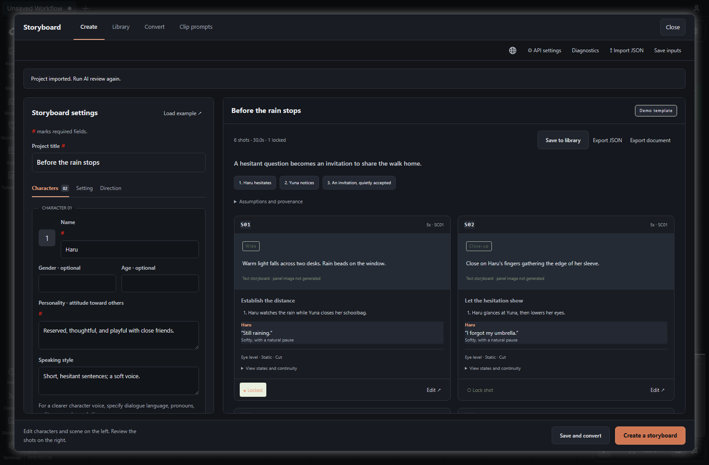
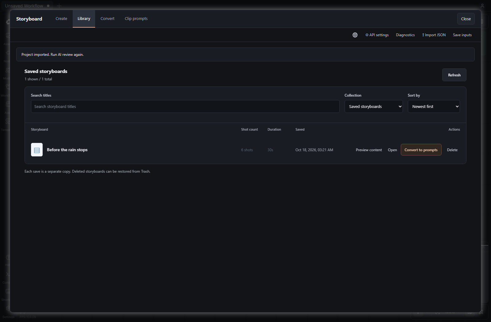
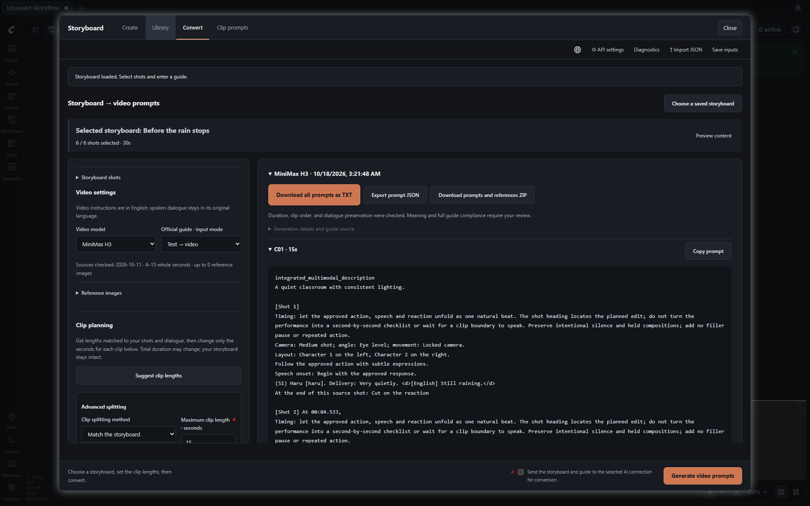
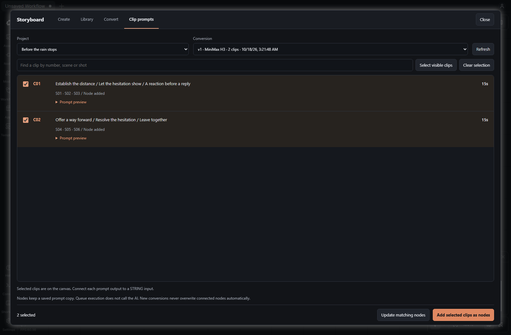
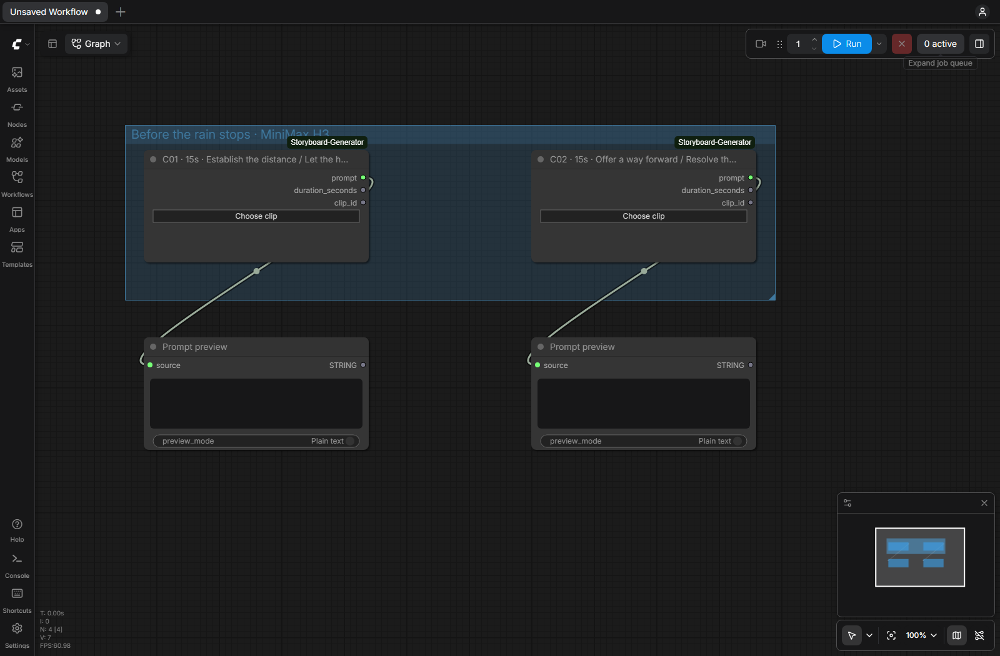

# ComfyUI Storyboard Generator

English | [한국어](README.ko.md) | [日本語](README.ja.md)

Create storyboards inside ComfyUI, convert them to MiniMax H3, Seedance or LTX 2.5 prompts, and connect each clip as a separate **STRING** output.

This is an independent ComfyUI node pack. The standalone [AI Video Storyboard Generator](https://github.com/impacifist/ai-video-storyboard-generator) remains independent. No separate web server is required.

## Finished animation example

[](https://github.com/impacifist/ComfyUI-Storyboard-Generator/releases/download/v0.1.2-beta/subway-conversation.mp4)

[Download the example video](https://github.com/impacifist/ComfyUI-Storyboard-Generator/releases/download/v0.1.2-beta/subway-conversation.mp4) · [Open the MP4](docs/demo/subway-conversation-web.mp4)

A 30-second storyboard excerpt rendered with MiniMax H3 and edited to 27.46 seconds. Character settings become dialogue, acting and camera direction; the Japanese dialogue was reviewed and corrected by the creator. This is a rendered example, separate from the mocked UI walkthrough below.



## A walkthrough in four steps

These are actual ComfyUI screenshots from an isolated demo session, with an English interface and an authored English story. Conversion responses are mocked for UI testing. These screenshots demonstrate the workflow, not the quality of a live AI generation or a finished video. Each language guide has its own matching interface and example.

### 1. Set up your story

Open **Storyboard** in the top action bar, then **API settings** to choose and configure your provider. In **Create**, enter your characters, setting, story direction, target duration and shot count. Add up to five personas, including personality and speaking style. Fields marked **#** are required.

Click **Create a storyboard**, review the shots on the right, and edit them before continuing. **Save and convert** saves a new copy and opens conversion. To explore the interface first, **Load example** fills the form; demo mode uses a template rather than an AI model.

To open the exact English example shown here, import the [English sample JSON](examples/before-the-rain-stops.storyboard.json). Saved projects can be reopened from **Library**.



### 2. Convert the approved shots into video prompts



Choose a saved storyboard and the **MiniMax H3**, **Seedance** or **LTX 2.5** guide. Review the selected shots and set your clip lengths; apply the split before generating prompts. This example uses a 30-second story split into two 15-second clips. Manual clip lengths can change the total, so review the split before conversion.

Select the conversion provider and model, approve the request checkbox, then click **Generate video prompts**. Review each result and use TXT, JSON or ZIP export if needed. With Ollama, you can also release the selected LLM after conversion; this does not unload ComfyUI's video models.

### 3. Select the clips you want on the canvas



In **Clip prompts**, choose the project and conversion version. Search by clip, scene or source shot, expand **Prompt preview**, select clips, then click **Add selected clips as nodes**. Connection status helps distinguish clips already on the canvas. Use **Update matching nodes** explicitly when you want a newer conversion; generating another version does not overwrite existing nodes.

### 4. Connect each prompt to your video workflow



The screenshot uses **PreviewAny** to demonstrate a real STRING connection without rendering a video. In your workflow, connect each clip's `prompt` output to the corresponding video prompt input. If the destination is a text widget, convert it to an input first when the node supports that option.

| Output | Type | What to connect |
| --- | --- | --- |
| `prompt` | STRING | The video node's prompt input or a string-processing node |
| `duration_seconds` | FLOAT | A compatible duration input, if your video workflow supports one |
| `clip_id` | STRING | Optional clip labels or other string inputs |

**Choose clip** reassigns an existing node while keeping its wires. Prompt copies travel with the saved workflow, and queue execution does not call the LLM again. Attach character and background reference images to the video-generation nodes separately, in the reference manifest's order. This addon prepares prompts; your video workflow handles rendering and joining clips.

## Use

1. Open **Storyboard** using the video icon in ComfyUI's top action bar, or **Extensions → Storyboard**. Use the single navigation row: **Create**, **Library**, **Convert**, **Clip prompts**.
2. In **Create**, configure your AI provider, enter 1–5 personas and the scene, then generate or import a storyboard. Inputs are on the left and editable results on the right. **Create a storyboard** stays in the bottom action bar. Edit and lock shots as needed; **Save and convert** saves a new library copy and opens it for conversion.
3. In **Convert**, choose the MiniMax H3, Seedance or LTX 2.5 guide, suggest clip lengths or apply a split, and edit individual clip durations. **Generate video prompts** stays in the bottom action bar. Source shots, references and Ollama memory settings fold away; open them when needed. TXT/JSON/ZIP exports remain available. The ComfyUI workbench follows the installed prompt writer's dark input/output layout; [design notes](docs/DESIGN_COMFYUI.md).
4. Open **Clip prompts**. Choose the project and conversion version, search by clip/scene/source shot, and preview the prompts.
5. Select clips and click **Add selected clips as nodes**. Each node exposes `prompt` (STRING), `duration_seconds` (FLOAT) and `clip_id` (STRING). Connect `prompt` directly to a compatible text input on a video node or a string-processing node. Text-only widgets need to support conversion to inputs before a wire can be attached.

Each node has a **Choose clip** button to assign a different clip without replacing the node or its wires. Nodes are grouped by project on the canvas. The list distinguishes added nodes, connected prompt outputs and nodes from another conversion. Searching does not clear your existing selection.

New conversions **do not automatically change existing nodes**. Select clips and choose **Update matching nodes** to explicitly update nodes for the same project and source-shot composition. If split boundaries change the source-shot composition, reassign the affected nodes individually. Conversion IDs separate versions; `C01` alone is never a global identity.

## Installation

Requires Python 3.12+ and a ComfyUI installation with frontend extension support. Place this repository in `ComfyUI/custom_nodes/ComfyUI-Storyboard-Generator`, restart ComfyUI, then refresh your browser. No additional runtime packages are installed by this node pack; aiohttp comes from ComfyUI.

From your `ComfyUI/custom_nodes` directory:

```sh
git clone https://github.com/impacifist/ComfyUI-Storyboard-Generator.git
```

For ZIP installation, extract the release into `custom_nodes/ComfyUI-Storyboard-Generator` so that `__init__.py` is directly inside that folder. Configure your AI provider in the panel after restarting ComfyUI. Supported providers include OpenAI, Anthropic Claude, Ollama, LM Studio and OpenAI-compatible endpoints. Local LLM software and model weights are installed separately.

The initial implementation targets the installed ComfyUI 0.41.1 / frontend 1.55.17. Compatibility with other versions must be checked separately. The top action button uses the installed frontend's `actionBarButtons` extension hook; the official commands/topbar-menu API provides an alternative entrypoint.

## Saved state and AI calls

### Ollama memory release

In the conversion screen, **Unload Ollama after prompt conversion** is enabled by default and remembered in this browser. The adapter unloads the selected Ollama model once, after the complete conversion, internal repairs and saved result. It does not unload between clips or batches. **Unload selected Ollama model now** uses the conversion's Ollama model, or the creation model if conversion uses another provider; the button shows the target model ID. The existing AI/settings lock rejects concurrent unload and generation operations within this addon.

The [official unload request](https://docs.ollama.com/faq#how-do-i-keep-a-model-loaded-in-memory-or-make-it-unload-immediately) sends an empty `/api/generate` request with `keep_alive: 0`, not a shell command or process kill. Only the configured local Ollama server and selected model are targeted. Confirmation requires `done: true` and `done_reason: unload`; unconfirmed/failed cleanup is shown separately and never discards saved prompts. Cleanup has a 15-second socket timeout. Failed conversions are not automatically cleaned up; the manual button remains available. Other applications sharing the same model may need to reload it. This does not measure freed VRAM or unload ComfyUI video models.

Queue execution still reads saved prompt snapshots without calling Ollama. No real Ollama model is unloaded during automated checks. See [implementation and evidence](docs/OLLAMA_MEMORY.md).

- Node snapshots include the selected prompt, duration and identity in workflow JSON. Reloading or sharing the workflow retains the exact prompt without needing the original local library. A checksum detects accidental changes; it is not an authenticity signature.
- Queue execution reads the saved snapshot only. It does not call AI, access a project database, refresh a prompt, or submit video generation.
- AI generation, review and conversion happen only when explicitly requested in the Studio. Existing engine validation and bounded repair behavior are retained.
- API keys are stored only in the local Studio settings, never in clip snapshots, graph properties or exports of the node workflow. Local settings are plaintext, as in the standalone app.
- Studio data is isolated under `ComfyUI/user/storyboard-generator/`. The actual location follows ComfyUI's user-directory setting; `STORYBOARD_DATA_DIR` can override it. The standalone app's settings and library are not automatically copied or changed.
- The initial routes allow loopback clients and same-origin requests only. Remote/multi-user access is outside this version's scope.
- Reference images remain managed by the Studio. This first node outputs prompt text and duration, not IMAGE tensors. Attach references to video nodes separately, in manifest order. No video rendering or automatic clip concatenation is included.

The Studio and wrapper support English, Korean and Japanese. Prompt directions are English; approved dialogue retains its original language.

## Shared engine

The engine and Studio assets are an unmodified, pinned snapshot of upstream v0.5.6-beta, not a separately maintained fork. `_vendor/upstream.json` records the full commit and SHA-256 of every imported file. ComfyUI integration lives outside `_vendor`. Loopback LLM requests have no application socket timeout; a model may take more than three minutes to return its first response. Local output budgets and session diagnostics are available in the embedded Studio.

The upstream application does not yet publish an installable engine package. This snapshot permits independent installation without downloading code at runtime or requiring the standalone server. A shared versioned Python package can replace it later.

To import a deliberate upstream revision from a local checkout:

```powershell
python tools/sync_upstream.py "C:\path\to\ai-video-storyboard-generator" <full-commit-or-tag>
```

The importer rejects changed snapshot files. Review upstream changes and run tests before shipping an updated snapshot.

## Development checks

```powershell
python -m unittest discover -s tests -p "test_*.py" -q
python -m ruff check .
node --check web/storyboard.js
node --check panel/bridge.js
```

Browser testing requires Playwright/Chromium in your development environment. `tools/test_comfy.py` launches a separate CPU-only ComfyUI instance with temporary input/output/user directories and only this custom node pack enabled. It seeds mocked conversions, exercises the real frontend and queues a string-only preview. It does not restart an existing ComfyUI instance or call paid AI/video services.

```powershell
python tools/test_comfy.py --comfy "C:\path\to\ComfyUI" --python "C:\path\to\python_embeded\python.exe"
```

See [architecture and implementation scope](docs/ARCHITECTURE.md).
